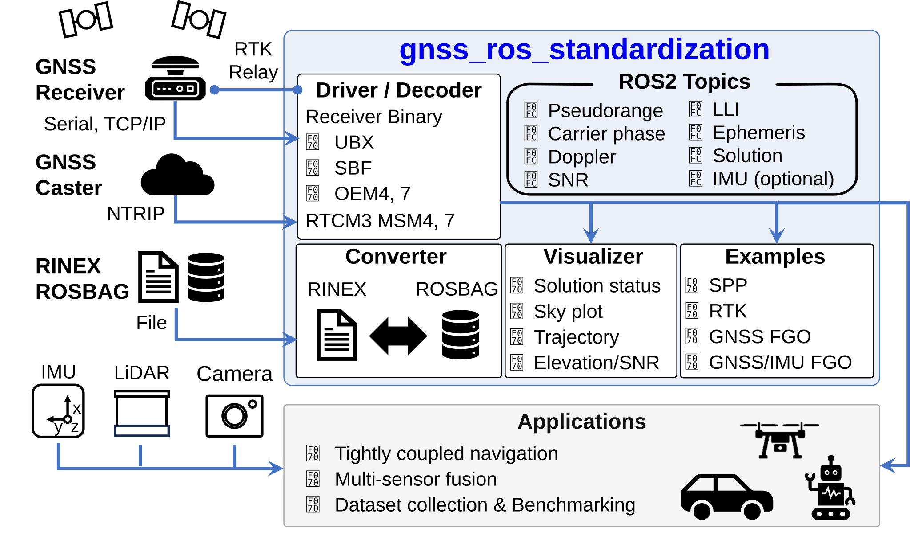
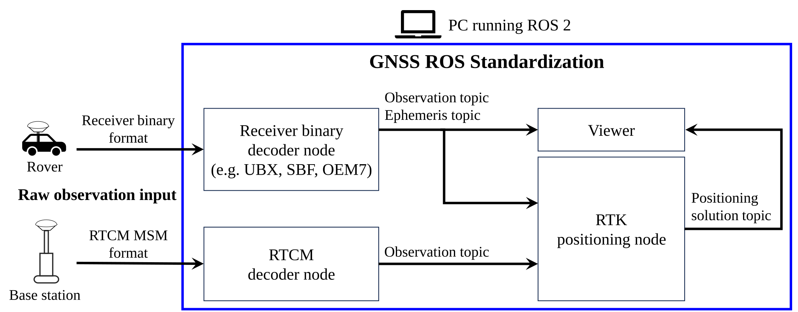

# gnss_ros_standardization

[](LICENSE)
[](https://docs.ros.org/en/jazzy/)

<p align="center">
  
</p>

ROS 2 package that publishes GNSS raw observations and navigation data from
u-blox, Septentrio, NovAtel and RTCM3 receivers as one common set of messages,
with drivers, bag/RINEX converters and positioning nodes (SPP, RTK, EKF, FGO).

## Demo

<p align="center">
  
</p>

<p align="center">
  
</p>

## Supported receivers

| Receiver | Observations | Navigation | Receiver solution | IMU |
|---|---|---|---|---|
| u-blox (UBX) | RXM-RAWX, RXM-RAW | RXM-SFRBX, RXM-SFRB | NAV-PVT, NAV-HPPOSLLH, NAV-HPPOSECEF, NAV-POSECEF, NAV-VELECEF, NAV-COV, NAV-DOP, NMEA | ESF-RAW, ESF-INS |
| Septentrio (SBF) | MeasEpoch, MeasExtra, Meas3 | GPS/GLO/GAL/BDS/QZS/NavIC Nav and raw navigation | PVTGeodetic, PVTCartesian, PosCov, VelCov, DOP, NMEA | ExtSensorMeas |
| NovAtel (OEM4/6/7) | RANGE, RANGECMP | GPS/GLO/GAL/BDS/QZS/NavIC EPHEM, IONUTC | BESTPOS, BESTVEL, BESTXYZ, PSRDOP, NMEA | RAWIMUSX, CORRIMUDATA |
| RTCM3 | MSM4–7, 1002, 1004, 1010, 1012 | 1019, 1020, 1041, 1042, 1044, 1045, 1046 | — | — |
| RINEX 3 (file) | observation files | navigation files | — | — |

Message IDs and topics per receiver: [decoders](src/decoders/README.md#decoded-messages).

## Nodes

| Group | Executables | Guide |
|---|---|---|
| Decoders (read a configured receiver) | `ubx_decoder_node`, `sbf_decoder_node`, `novatel_decoder_node`, `rtcm_decoder_node` | [decoders](src/decoders/README.md) |
| Drivers (configure the receiver, then decode) | `ubx_driver_node`, `sbf_driver_node`, `novatel_driver_node` | [drivers](src/drivers/README.md) |
| Converters | `rinex_to_rosbag`, `rosbag_to_rinex`, `pos_to_rosbag`, `rosbag_to_pos` | [converters](src/converter/README.md) |
| Positioning | `single_point_positioning`, `real_time_kinematic`, `gnss_imu_kalman_filter`, `gnss_fgo`, `gnss_imu_fgo` | [positioning](src/positioning/README.md) |
| Visualizer | `gnss_visualizer` | [visualizer](src/utils/README.md) |
| Launch | `pipeline.launch.py` (logging, RTK, FGO, EKF, on-chip RTK) | [pipelines](launch/README.md) |

Messages: [msg/README.md](msg/README.md).

## Installation

Ubuntu 24.04, ROS 2 Jazzy:

```bash
source /opt/ros/jazzy/setup.bash
git clone --recursive https://github.com/DaikiNiimi/gnss_ros_standardization.git
cd gnss_ros_standardization
rosdep install --from-paths . --ignore-src -r -y
colcon build --cmake-args -DCMAKE_BUILD_TYPE=Release
source install/setup.bash
```

If the clone omitted the RTKLIB submodule: `git submodule update --init --recursive`.

### FGO nodes (optional, need GTSAM)

```bash
bash cmake/build_fgo_dependency.sh "$HOME/fgo-dependency" 2
colcon build --cmake-args -DCMAKE_BUILD_TYPE=Release \
  -DBUILD_FGO_NODES=ON \
  -DGTSAM_DIR="$HOME/fgo-dependency/install/lib/cmake/GTSAM"
```

The script builds GTSAM (borglab/gtsam `develop`, commit
`6f31b6df3b56b60ec82d3218b47a2163bb41dd34`) with the settings the FGO nodes need.

### Build options

| CMake option | Default | Builds |
|---|---|---|
| `BUILD_UBX_DECODER_NODE`, `BUILD_SBF_DECODER_NODE`, `BUILD_NOVATEL_DECODER_NODE`, `BUILD_RTCM_DECODER_NODE` | `ON` | decoders |
| `BUILD_UBX_DRIVER_NODE`, `BUILD_SBF_DRIVER_NODE`, `BUILD_NOVATEL_DRIVER_NODE` | `ON` | drivers |
| `BUILD_RINEX_WRITER_TOOL` | `ON` | `rosbag_to_rinex` |
| `BUILD_SPP_NODE`, `BUILD_RTK_NODE`, `BUILD_EKF_NODE` | `ON` | SPP, RTK, EKF |
| `BUILD_FGO_NODES` | `OFF` | `gnss_fgo`, `gnss_imu_fgo` |
| `ENABLE_GLO`, `ENABLE_GAL`, `ENABLE_BDS`, `ENABLE_QZS`, `ENABLE_SBS`, `ENABLE_IRN` | `ON` | constellations compiled into RTKLIB |

## Quick start

Read a receiver that already outputs raw observations and navigation data:

```bash
ros2 run gnss_ros_standardization ubx_decoder_node --ros-args \
  -p stream_path:=serial:///dev/ttyACM0:115200
ros2 topic echo /gnss/observation --once
```

Configure the receiver on startup instead:

```bash
ros2 run gnss_ros_standardization ubx_driver_node --ros-args \
  --params-file config/ubx_driver.yaml
```

Logging, RTK, FGO and EKF with one command (settings in `config/site.yaml`):

```bash
ros2 launch gnss_ros_standardization pipeline.launch.py
```

A recorded binary log is read with `stream_path:=file:///absolute/path/log.ubx`.

## Dataset

[PPC-Dataset-ROS2](https://github.com/DaikiNiimi/PPC-Dataset-ROS2) provides the six
vehicle runs (Nagoya and Tokyo) of the [PPC-Dataset](https://github.com/taroz/PPC-Dataset)
as ROS 2 bags in this package's messages: rover and base observations, ephemerides,
IMU and ground truth. Replay a run into a positioning node (from this repository's
directory; [config/ppc/](config/ppc/) holds the settings of each city):

```bash
ros2 launch gnss_ros_standardization pipeline.launch.py pipeline:=rtk replay:=true \
  params_file:=$PWD/config/ppc/tokyo_rtk.yaml &
ros2 bag play /path/to/PPC-Dataset-ROS2/bags/tokyo_run1
```

## Documentation

| Topic | Document |
|---|---|
| Message fields, time, frames, missing values | [topic contract](docs/TOPIC_DATA_CONTRACT.md), [messages](msg/README.md) |
| Receiver messages | [decoders](src/decoders/README.md#decoded-messages), [drivers](src/drivers/README.md#output-messages) |
| Parameter names | [parameter names](docs/PARAMETER_NAMES.md) |
| Using the installed package from another package | [installed API](docs/INSTALLED_API.md) |
| Tests | [tests](test/README.md) |
| ROS 2 bags of the PPC dataset | [dataset](#dataset) |

## License

MIT, see [LICENSE](LICENSE) (includes the RTKLIB notice). GTSAM, when used, has its
own license. Maintainer: Daiki Niimi (`dai12.gnss@gmail.com`).
