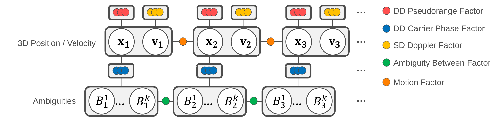
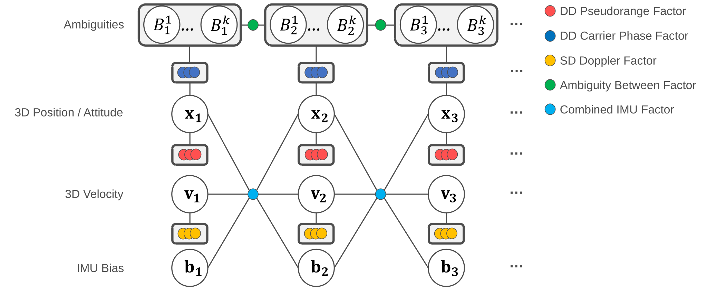

# `gnss_fgo` / `gnss_imu_fgo`

Tightly coupled factor graph optimization with GTSAM (incremental fixed-lag
smoother, 1 s lag): double-differenced (DD) code and carrier factors, Doppler
factors, integer ambiguity resolution (LAMBDA, ratio test 3.0) and hold.

| Executable | Motion model | Inputs |
|---|---|---|
| `gnss_fgo` | constant velocity (antenna position and velocity) | rover and base observations, ephemeris |
| `gnss_imu_fgo` | IMU preintegration (pose, velocity, IMU bias) | rover and base observations, ephemeris, IMU |

Build them with `-DBUILD_FGO_NODES=ON` ([installation](../../../README.md#fgo-nodes-optional-need-gtsam)).

```bash
ros2 run gnss_ros_standardization gnss_imu_fgo --ros-args \
  --params-file config/gnss_imu_fgo.yaml \
  -p base_position.postype:=llh -p "base_position.pos:=[35.0, 139.0, 50.0]"
```

`base_position.pos` (the surveyed base position) must be set; the nodes do not start
with the default `[0, 0, 0]`. Settings for the PPC dataset routes are in
[config/ppc/](../../../config/ppc/).

## Factor graphs

### `gnss_fgo`

<p align="center"></p>

| Factor | Connects |
|---|---|
| constant-velocity motion (white acceleration) | position and velocity of consecutive epochs |
| DD pseudorange | position |
| DD carrier phase | position, ambiguities |
| SD Doppler | velocity |
| ambiguity continuity / prior | ambiguities of consecutive epochs |

### `gnss_imu_fgo`

<p align="center"></p>

| Factor | Connects |
|---|---|
| IMU preintegration (`CombinedImuFactor`) | pose, velocity, bias of consecutive epochs |
| bias random walk / bias prior | IMU bias |
| DD pseudorange (with lever arm) | pose |
| DD carrier phase (with lever arm) | pose, ambiguities |
| SD Doppler (with lever arm) | pose, velocity |
| non-holonomic constraint | pose, velocity |
| zero velocity (ZUPT) | velocity, pose (when stationary) |
| ambiguity continuity / prior | ambiguities of consecutive epochs |

`gnss_imu_fgo` starts with GNSS only and switches to the GNSS/IMU graph after
5 consecutive FIX epochs while moving.

## Topics

| Direction | Parameter | Default | Type |
|---|---|---|---|
| sub | `topics.rover_observation` | `/gnss/observation` | `GnssObservations` |
| sub | `topics.base_observation` | `/base/gnss/observation` | `GnssObservations` |
| sub | `topics.ephemeris` | `/gnss/ephemeris` | `GnssEphemerides` |
| sub | `topics.imu` (`gnss_imu_fgo`) | `/gnss/imu/data_raw` | `sensor_msgs/Imu` |
| pub | `topics.solution` | `/gnss/fgo/solution`, `/gnss/imu_fgo/solution` | `GnssSolution` (antenna) |
| pub | `<topics.solution>_odom` (`gnss_imu_fgo`) | | `nav_msgs/Odometry` (IMU body pose in ENU, `map` → `imu_link`) |

The shipped YAML files publish on `/gnss/solution`.

## Parameters

| Parameter | Default | Meaning |
|---|---|---|
| `algorithm_profile` | `gnss_motion_ratio3_v1` / `ratio3_direct_v1` | model profile (fixed) |
| `base_position.postype`, `.pos` | `ecef`, `[0,0,0]` | surveyed base position (`ecef`: m; `llh`: deg, deg, m) |
| `initial_position.postype`, `.pos` | `ecef`, base | approximate rover start position |
| `local_origin.mode`, `.postype`, `.pos` | `auto`, `llh`, `[0,0,0]` | ENU origin of `pos_enu` and the odometry: `auto` = base position, `fixed` = `pos` |
| `lever_arm` (`gnss_imu_fgo`) | `[0,0,0]` | IMU to antenna in the IMU message axes (FLU), metres |
| `imu_orientation` (`gnss_imu_fgo`) | `[0,0,0]` | IMU sensor to body rotation, roll/pitch/yaw in radians |
| `signals.<rover\|base>.<G\|E\|J\|C>.<P\|L\|D\|S>` | GPS/QZSS `[1C, 2W, 5Q]`, Galileo `[1X, 5X, 7X]`, BeiDou `[2I, 7I, 6I]` | RINEX signal codes used per receiver, constellation and measurement type (up to three bands; P, L and S in the same band order) |
| `max_age_s` | `30.0` | maximum age of the base observation paired with a rover epoch (≥ 0) |
| `queue_depth` | `4096` | input queue length (1–1 000 000) |
| `debug.trace_directory` | `""` | write per-epoch trace files |
| `debug.end_topic` | `""` | a `std_msgs/String` on this topic processes all pending epochs (for bag replay) |
| `debug.navigation_indices_in_frame_id` | `false` | take ephemeris record indices from the input `frame_id` (replay test harness) |

GLONASS is not used. A parameter the node does not declare stops it at startup.

## Notes

- The header time scale (UTC or GPST) follows the rover observations; IMU stamps
  must be on the same clock (receiver GNSS time stamps, `use_gps_timestamp: true`).
- Solution status: FIX or FLOAT with a GNSS update, DR when only the motion model or
  the IMU propagates the state, NONE (NaN position) before initialization.
- A rover, base or IMU clock that steps back more than 5 s starts a new time line.
- On shutdown the node prints a summary of received, solved and dropped inputs.
