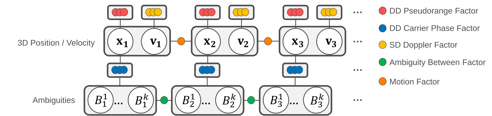
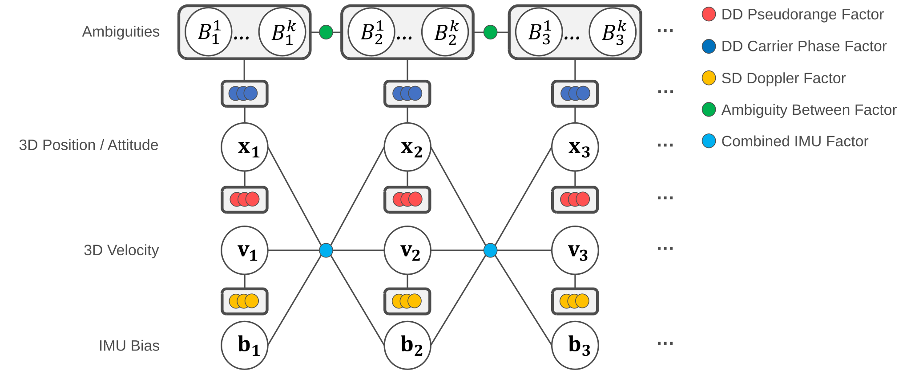

# `gnss_fgo` / `gnss_imu_fgo`

Tightly coupled factor graph optimization with GTSAM's `IncrementalFixedLagSmoother`:
GTSAM's double-differenced (DD) code and carrier factors
(`DoubleDifferencePseudorangeFactorArm`, `DoubleDifferenceCarrierPhaseFactorArm`),
between-satellite Doppler factors, integer ambiguity resolution (RTKLIB `lambda()`
with a ratio test) and hold.

| Executable | Motion model | Inputs |
|---|---|---|
| `gnss_fgo` | constant velocity (antenna position and velocity) | rover and base observations, ephemeris |
| `gnss_imu_fgo` | IMU preintegration (pose, velocity, IMU bias) | rover and base observations, ephemeris, IMU |

Build them with `-DBUILD_FGO_NODES=ON` ([installation](../../../README.md#fgo-nodes-optional-need-gtsam)).

```bash
ros2 run gnss_ros_standardization gnss_imu_fgo --ros-args \
  --params-file config/gnss_imu_fgo.yaml \
  -p base_position.postype:=llh -p "base_position.pos:=[35.0, 139.0, 50.0]"
```

`base_position.pos` (the surveyed base position) must be set; the nodes do not start
with the default `[0, 0, 0]`. Settings for the PPC dataset routes are in
[config/ppc/](../../../config/ppc/).

## Factor graphs

"From" tells whether the factor class is GTSAM's or defined in this package
([model.hpp](model.hpp)).

### `gnss_fgo`

State per epoch: a `Pose3` (antenna position; its rotation is held at identity by a
`PoseRotationPrior`) and a velocity.

<p align="center"></p>

| Factor | Class | From | Connects |
|---|---|---|---|
| constant velocity (white acceleration) | `MotionFactor` | this package | pose and velocity of consecutive epochs |
| rotation prior | `PoseRotationPrior<Pose3>` | GTSAM | pose |
| start prior (first epoch, after a reset) | `PriorFactor<Pose3>`, `PriorFactor<Vector3>` | GTSAM | pose, velocity |
| DD pseudorange | `DoubleDifferencePseudorangeFactorArm` | GTSAM | pose |
| DD carrier phase | `DoubleDifferenceCarrierPhaseFactorArm` | GTSAM | pose, reference and target ambiguity |
| between-satellite Doppler | `SdDopplerFactor` | this package | pose, velocity |
| ambiguity prior (where its arc starts; after a hold release, at the held value) | `PriorFactor<double>` | GTSAM | one ambiguity |
| ambiguity gauge prior (where a constellation/band group starts) | `PriorFactor<double>` | GTSAM | reference ambiguity of the group |
| hold (`hold.variance_cycles2`) | `BetweenFactor<double>` | GTSAM | the two ambiguities of each fixed pair |

Ambiguities: one variable per satellite and band, shared by all epochs of a carrier
arc. An arc ends at a slip, a hold release, a reset or an epoch without its carrier
DD factor; the next arc gets a new variable. No factor links two arcs.

### `gnss_imu_fgo`

<p align="center"></p>

| Factor | Class | From | Connects |
|---|---|---|---|
| IMU preintegration | `CombinedImuFactor` | GTSAM | pose, velocity, bias of consecutive epochs |
| bias between | `BetweenFactor<imuBias::ConstantBias>` | GTSAM | bias of consecutive epochs |
| bias prior (`imu.bias_prior_mode`) | `PriorFactor<imuBias::ConstantBias>` | GTSAM | bias |
| start (switch window epochs) | `PriorFactor`, `GPSFactorArm` | GTSAM | pose, velocity, bias |
| prediction prior (GNSS epoch with fewer than 4 DD factors) | `PriorFactor` | GTSAM | pose, velocity, bias |
| DD pseudorange (with lever arm) | `DoubleDifferencePseudorangeFactorArm` | GTSAM | pose |
| DD carrier phase (with lever arm) | `DoubleDifferenceCarrierPhaseFactorArm` | GTSAM | pose, reference and target ambiguity |
| between-satellite Doppler (with lever arm) | `SdDopplerFactor` | this package | pose, velocity |
| non-holonomic constraint (`nhc.enable`) | `NhcFactor` | this package | pose, velocity |
| zero velocity (`zupt.enable`, stationary, previous speed below 0.5 m/s) | `PriorFactor<Vector3>`, `BetweenFactor<Pose3>`, `PriorFactor<Pose3>` | GTSAM | velocity; consecutive poses; pose |
| ambiguity prior, gauge prior, hold | as in `gnss_fgo` | GTSAM | ambiguities |

`gnss_imu_fgo` runs the `gnss_fgo` graph, and publishes its solution, until the IMU graph starts:
- Start: 1 s of consecutive GNSS epochs with at least 4 DD factors, horizontal speed ≥ 1 m/s, yaw rate < 3 deg/s, and a Doppler-only velocity within 20 deg and max(0.5 m/s, 30 %) of the estimated velocity.
- Initial attitude: heading from the velocity direction, roll and pitch from the accelerometer; forward when the GNSS and accelerometer speed changes (each ≥ 0.5 m/s) have the same sign, reverse when not, otherwise forward when ≥ 5 m/s throughout.
- Return to a new `gnss_fgo` graph: for 2 s, the body x axis more than 45 deg off the Doppler-only velocity (at ≥ 5 m/s), or the DD code residual check resetting the ambiguities in every GNSS epoch.

## Topics

| Direction | Parameter | Default | Type |
|---|---|---|---|
| sub | `topics.rover_observation` | `/gnss/observation` | `GnssObservations` |
| sub | `topics.base_observation` | `/base/gnss/observation` | `GnssObservations` |
| sub | `topics.ephemeris` | `/gnss/ephemeris` | `GnssEphemerides` |
| sub | `topics.imu` (`gnss_imu_fgo`) | `/gnss/imu/data_raw` | `sensor_msgs/Imu` |
| pub | `topics.solution` | `/gnss/solution` | `GnssSolution` (antenna) |
| pub | `<topics.solution>_odom` (`gnss_imu_fgo`) | | `nav_msgs/Odometry` (IMU graph only) |

The odometry is the body pose in ENU (origin `local_origin.*`), `frame_id` `map`,
`child_frame_id` `imu_link`; the twist is in body axes; covariances are NaN.

## Parameters

| Parameter | Default | Meaning |
|---|---|---|
| `base_position.postype`, `.pos` | `ecef`, `[0,0,0]` | surveyed base position (`ecef`: m; `llh`: deg, deg, m) |
| `initial_position.postype`, `.pos` | `ecef`, base | approximate rover start position |
| `local_origin.mode`, `.postype`, `.pos` | `auto`, `llh`, `[0,0,0]` | ENU origin of `pos_enu` and the odometry: `auto` = base position, `fixed` = `pos` |
| `lever_arm` (`gnss_imu_fgo`) | `[0,0,0]` | IMU to antenna in body axes (FLU, after `imu_orientation`), metres |
| `imu_orientation` (`gnss_imu_fgo`) | `[0,0,0]` | IMU sensor to body rotation, roll/pitch/yaw in radians |
| `max_age_s` | `30.0` | maximum age of the base observation paired with a rover epoch (≥ 0) |
| `queue_depth` | `4096` | QoS depth of the observation and IMU subscriptions and the publishers (1–1 000 000) |
| **Observations** (same names as `real_time_kinematic`) | | |
| `frequencies.enable_l1` / `_l2` / `_l5` | `true` / `true` / `false` | frequency bands used |
| `pos1.elmask` | `15.0` | elevation mask, degrees |
| `pos1.navsys.gps` / `.gal` / `.bds` / `.qzs` | `true` | constellations used |
| `pos1.snrmask.rover` / `.base` | `false` | apply the SNR mask to the receiver |
| `pos1.snrmask.l1` / `.l2` / `.l5` | nine zeros | SNR mask of the band at 5, 15, ..., 85 degrees, dBHz |
| `excluded_satellites` | `[]` | satellites not used (`G01`, ...) |
| `pos2.armode` | `3` | `0` no ambiguity resolution, `3` fix and hold (no other value) |
| `pos2.arthres` | `3.0` | ratio test threshold |
| `pos2.minfixsats` | `4` | minimum satellites to fix |
| `pos2.slipthres` | `0.15` | geometry-free slip threshold, metres |
| **Model** | | |
| `noise.doppler_mps` | `0.5` | lowest Doppler sigma, m/s (raised by the residual scatter, low elevation and low SNR); `0`: no Doppler factors (`gnss_imu_fgo` then stays on the `gnss_fgo` graph) |
| `graph.lag_s` | `1.0` | smoother window, seconds (the IMU graph uses at least the switch window plus one epoch interval) |
| `hold.variance_cycles2` | `0.001` | variance of a hold factor, cycles² |
| `ambiguity.exclude_bds_geo` | `true` | leave BeiDou GEO satellites (C01–C05, C59–C63) out of the DD factors |
| `fde.enable` / `fde.pseudorange_m` / `fde.carrier_m` | `true` / `4.0` / `0.5` | remove DD factors whose residual exceeds the threshold, metres |
| `motion.acceleration_psd` (`gnss_fgo`) | `9.0` | white-acceleration density, m²/s³ |
| **IMU** (`gnss_imu_fgo`) | | |
| `imu.gravity_mps2` | `9.81` | gravity magnitude |
| `imu.sigma_acc` | `0.00284` | accelerometer noise density, m/s²/√Hz |
| `imu.sigma_gyr` | `0.00401` | gyroscope noise density, rad/s/√Hz |
| `imu.integration_covariance` | `0.001` | GTSAM preintegration `integrationCovariance` (diagonal) |
| `imu.sigma_acc_bias` | `0.000314` | accelerometer bias random walk, m/s²/√s |
| `imu.sigma_gyr_bias` | `9.7e-06` | gyroscope bias random walk, rad/s/√s |
| `imu.bias_prior_sigma_acc_mps2` / `imu.bias_prior_sigma_gyr_rps` | `0.003` / `0.0003` | per-epoch bias prior |
| `imu.bias_prior_mode` | `2` | prior mean: `0` none, `1` initial bias, `2` latest estimate |
| `nhc.enable` | `false` | non-holonomic constraint (ground vehicles) |
| `nhc.sigma_lat_mps` / `nhc.sigma_vert_mps` | `0.3` / `0.2` | constraint sigma |
| `nhc.lever_arm` | `[0,0,0]` | IMU to the point where the constraint holds, body axes, metres |
| `zupt.enable` | `false` | zero-velocity update (ground vehicles) |
| `zupt.max_acc_std` / `zupt.max_gyr_std` | `0.55` / `0.03` | stationary detection: standard deviation of the epoch's IMU samples, m/s² / rad/s |
| `zupt.sigma_mps` | `0.5` | zero-velocity sigma |
| `init.pitch_deg` | `NaN` | initial pitch, degrees (`NaN`: from the accelerometer) |
| **Debug** | | |
| `debug.trace_directory` | `""` | directory for `intake-trace.jsonl` (base observation paired with each rover epoch) and, at the end marker, `intake-summary.json` and `solver-completed` |
| `debug.end_topic` | `""` | a `std_msgs/String` `end` on this topic solves all pending epochs and stops the node (bag replay) |

The signal of each band is chosen automatically as in `real_time_kinematic`, per
rover/base pair. A satellite is used on every band it has been tracked on with code
and phase, or not at all: when one of those bands is missing or below the SNR mask,
the satellite is left out for that receiver in that epoch.

Only GPS, Galileo, QZSS and BeiDou are used. A parameter the node does not declare
stops it at startup.

## Notes

- The header time scale (UTC or GPST) follows the rover observations; IMU stamps
  must be on the same clock (receiver GNSS time stamps, `use_gps_timestamp: true`).
- IMU samples must be at most 0.1 s apart.
- Solution status: FIX when the epoch's integer search is accepted, FLOAT for another
  GNSS update, DR when the epoch adds no DD factor and the motion model or the IMU
  carries the state, NONE (NaN position) when there is no estimate.
- A rover, base or IMU clock that steps back more than 5 s starts a new time line.
- On shutdown the node prints a summary of received, solved and dropped inputs.
