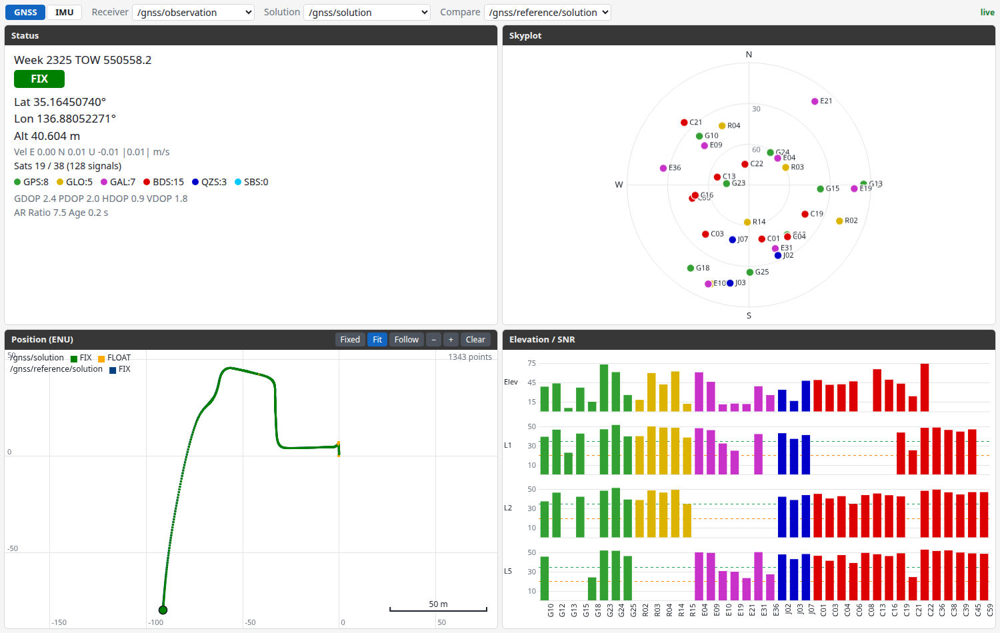
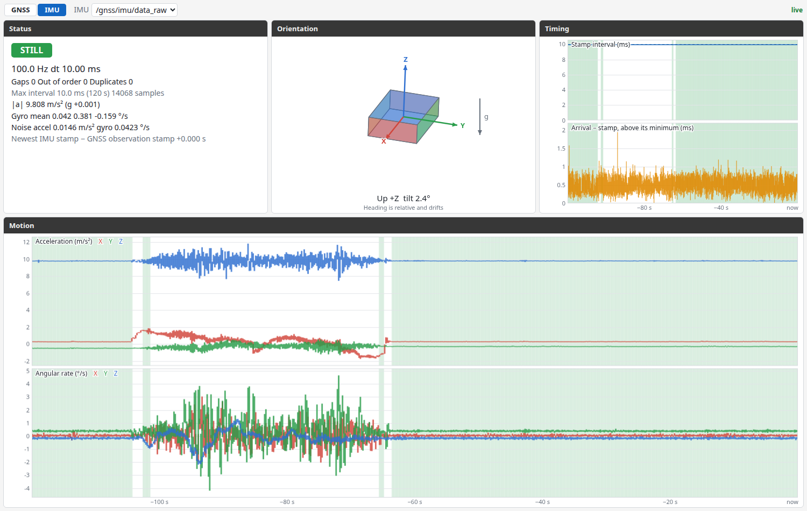
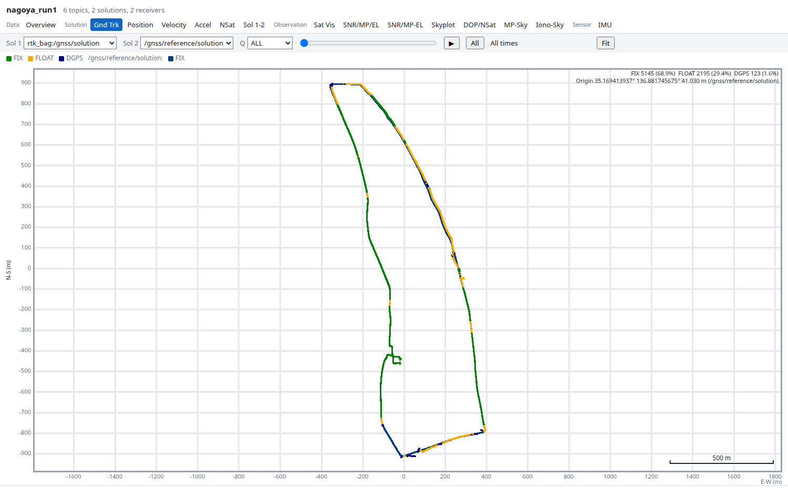
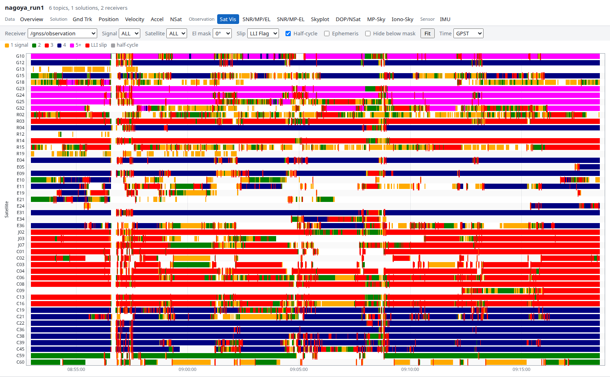

# gnss_visualizer

Live dashboard for one receiver, shown in a web browser. The `GNSS` page shows
status, skyplot, ENU trajectory and per-satellite elevation/SNR; the `IMU` page
shows data health, sensor orientation, stamp quality and motion.

```bash
ros2 run gnss_ros_standardization gnss_visualizer
```

Open <http://127.0.0.1:8765/>. Topics are found by message type when the page is
opened or reloaded; choose what to show in Receiver, Solution, Compare and IMU.
The choice is shared by every page connected to the node.

<p align="center">
  
</p>

<p align="center">
  
</p>

Pictures: replay of Nagoya run 1 of the [PPC-Dataset](https://github.com/taroz/PPC-Dataset).

| GNSS panel | Content |
|---|---|
| Status | week/TOW, solution status, latitude/longitude/height, ENU velocity, satellites per constellation, DOP, AR ratio, differential age |
| Skyplot | satellite azimuth/elevation by constellation |
| Position (ENU) | trajectory colored by solution status, a second solution to compare, scale bar |
| Elevation / SNR | per-satellite elevation and L1/L2/L5 SNR |

| IMU panel | Content |
|---|---|
| Status | still or moving, rate, gap and out-of-order counts, a warning when gyro and accelerometer disagree on the axes; at rest: specific force norm, gyro mean, noise; newest IMU stamp minus newest GNSS observation stamp |
| Orientation | sensor axes in a level frame and the axis closest to up. Display only; heading is relative and drifts |
| Timing | stamp intervals, and arrival time minus stamp above its minimum |
| Motion | last 120 s, shaded while still: acceleration and angular rate on the sensor X/Y/Z axes |

A topic without gravity, such as `/gnss/imu/data`, shows no orientation.
Orientation expects right-handed axes, as `sensor_msgs/Imu` does; the warning
needs tilting, so a vehicle on flat roads may not trigger it.

## Topics

`topics.observation`, `topics.solution` and `topics.imu` are only the initial
choice. Every `GnssEphemerides` topic is used, and ephemerides are kept until the
node stops.

| Parameter | Default | Type |
|---|---|---|
| `topics.observation` | `/gnss/observation` | `GnssObservations` |
| `topics.ephemeris` | `/gnss/ephemeris` | `GnssEphemerides` |
| `topics.solution` | `/gnss/nmea_solution` | `GnssSolution` |
| `topics.imu` | `/gnss/imu/data_raw` | `sensor_msgs/Imu` |

## Parameters

| Parameter | Default | Meaning |
|---|---|---|
| `port` | `8765` | TCP port of the page |
| `bind_address` | `127.0.0.1` | IPv4 address to serve on. `0.0.0.0` lets any device on the network see the position, without authentication; only a page on this computer can change the selection |
| `recent_window_s` | `60.0` | trajectory kept at full rate |
| `decimate_old_dt_s` | `1.0` | spacing of older trajectory points |
| `max_history` | `50000` | maximum trajectory points |
| `manual_position.pos`, `.postype` | `[0,0,0]`, `llh` | position shown and used for the skyplot while there is no solution (`llh`: deg, deg, m; `ecef`: m; `[0,0,0]` = none) |

## Page controls

| Input | Action |
|---|---|
| `GNSS`, `IMU` | page shown, for this browser tab only; `#imu` in the address opens the IMU page |
| Receiver, Solution, Compare, IMU | topics shown |
| `Fixed`, `Fit`, `Follow` | position panel view |
| `+` / `−` buttons, mouse wheel | zoom |
| drag | pan |
| `Clear` | clear the trajectory on this page |

# rtk_bag_plot

Reads a rosbag2 bag directly, without `ros2 bag play`, and writes one self-contained
HTML report with RTKPLOT-style plots. The report opens in any web browser, needs no
network and can be shared without ROS.

<p align="center">
  
</p>

<p align="center">
  
</p>

Pictures: the same run, with an RTK solution of this package compared with the
dataset's reference through `--compare`.

```bash
ros2 run gnss_ros_standardization rtk_bag_plot ./my_bag
```

| Option | Default | Meaning |
|---|---|---|
| `<bag>`, `--bag <bag>` | required | bag directory, `sqlite3` or `mcap`, plain or compressed |
| `--out <file.html>` | `<bag>.html` next to the bag | output file |
| `--pos <file.pos>` | none | RTKLIB position file to compare, repeatable |
| `--compare <bag>` | none | another bag whose solutions are compared, repeatable |
| `--stat <file.stat>` | none | RTK solution status file (`debug.solstatus_path`) for the residual plots |
| `--no-open` | off | do not open the browser |
| `--help`, `--version` | | |

Topics are detected by message type, so the topic names do not matter. Solutions
from `--pos` and `--compare` are matched by GPST and appear in Sol 1 and Sol 2.

```bash
ros2 run gnss_ros_standardization rtk_bag_plot ./rtk_bag --compare ./fgo_bag --pos reference.pos
```

| Plot | Needs | Content |
|---|---|---|
| Overview | | rate, gaps and timing of every topic; solution quality |
| Gnd Trk, Position, Velocity, Accel, NSat, Sol 1-2 | `GnssSolution` | quality colors, AVE/STD/RMS, scale bar in Gnd Trk |
| Sat Vis | `GnssObservations` | tracked signals per satellite; `ALL`, a frequency or a code colored by SNR; LLI or LG-jump marks; ephemeris |
| SNR/MP/EL, SNR/MP-EL | `GnssObservations` | SNR, multipath and elevation per signal and satellite |
| Skyplot, DOP/NSat, MP-Sky, Iono-Sky | `GnssObservations`, `GnssEphemerides` | satellite geometry |
| Residuals, Resid-EL, Sol Sky, Sol DOP | `--stat` | RTKLIB level-2 residuals |
| IMU | `sensor_msgs/Imu` | acceleration and angular rate |

| Input | Action |
|---|---|
| wheel | zoom |
| drag | pan |
| click | set the time cursor |
| `Fit` | show the whole plot and keep the selected time |
| double click | reset the view and clear the selected time |
| satellite label in Sat Vis | open SNR/MP/EL for that satellite |
| point in a sky plot | show satellite, time, azimuth and elevation; click to select that time |
| time slider, play button in solution, sky and IMU plots | move the selected time |
| point in Gnd Trk | select that time |
